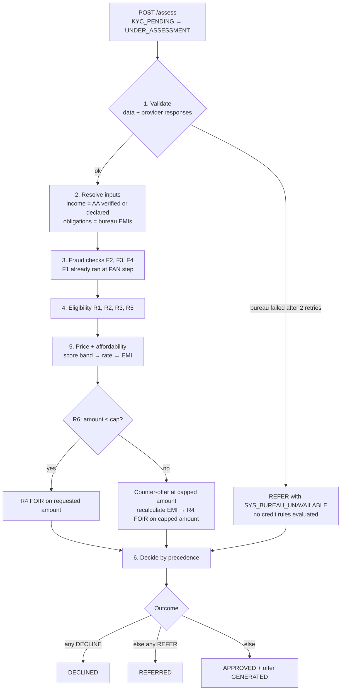

# Decision Engine — Rules, Fraud Checks, Pricing

> Demo prototype. Simulated integrations and synthetic data. Not affiliated with any bank or lender.
> All thresholds below are **illustrative defaults** for a fictional lender. They are editable in the admin UI without a code change.

## 1. Policy model

Policy lives in the `rule_configs` table and is seeded from `backend/policy/seed_policy.json`.

| Field | Meaning |
|---|---|
| `rule_id` | `R1`–`R6` (eligibility), `F1`–`F4` (fraud), `PRICING` (rate bands, fee, product limits) |
| `kind` | `ELIGIBILITY`, `FRAUD` or `PRICING` |
| `name` | Human-readable name |
| `enabled` | If `false`, the rule is skipped and recorded as `SKIPPED` in the inputs snapshot |
| `parameters` | JSON thresholds (schema per rule below; validated on save) |
| `outcome_on_fail` | `DECLINE` or `REFER` (rules with banded outcomes define both in `parameters`) |
| `reason_codes` | Codes this rule can emit |
| `version` | The policy version in which this row was created |
| `created_by`, `created_at`, `change_comment` | Audit fields |

**Versioning.** The policy version is one increasing integer for the whole policy. Saving a change to any rule creates a new row for that rule with `version = current + 1`; old rows are never updated or deleted. Policy version *N* is the latest row per `rule_id` with `version ≤ N`. Every decision and offer stores the `policy_version` it used, so any past decision can be replayed exactly (EC-15). Rationale: [DECISIONS.md D-14](DECISIONS.md).

**Counts.** There are exactly **6 eligibility rules** (R1–R6) and **4 fraud checks** (F1–F4), each implemented as executable code with tests. `PRICING` is configuration, not a rule.

### Seed policy shape (abridged)

```json
{
  "policy_version": 1,
  "source": "Illustrative calibration to the 37.3% approval-rate scenario from the credit-risk cut-off project; does not establish equivalent risk.",
  "rules": [
    {"rule_id": "R1", "kind": "ELIGIBILITY", "name": "Age", "enabled": true,
     "parameters": {"min_age_now": 21, "max_age_at_maturity": 60},
     "outcome_on_fail": "DECLINE", "reason_codes": ["ELIG_AGE"]},
    {"rule_id": "R2", "kind": "ELIGIBILITY", "name": "Credit score", "enabled": true,
     "parameters": {"approve_threshold": "<set by seed_policy_from_cutoff.py>",
                    "refer_floor": "<set by seed_policy_from_cutoff.py>",
                    "ntc_outcome": "REFER",
                    "calibration": {"reference_approval_rate": 0.373, "refer_band_width": 0.15}},
     "outcome_on_fail": "DECLINE",
     "reason_codes": ["ELIG_SCORE_LOW", "ELIG_SCORE_BORDERLINE", "ELIG_THIN_FILE"]}
  ]
}
```

R2 values are deliberately left as placeholders until the seeding script runs in Phase 3. No threshold value is written into these docs by hand.

---

## 2. Evaluation sequence



1. **Validate.** Check application data and provider responses. If a required provider (credit bureau) failed after retries, stop and REFER with a `SYS_*` code. A missing response is never treated as a failed credit rule.
2. **Resolve inputs.** Income = AA-verified average monthly income if consent was approved, else declared income (plus `DATA_INCOME_UNVERIFIED`). Existing obligations = bureau existing monthly EMIs. Date of birth = e-KYC DOB.
3. **Fraud checks F2–F4.** F1 already ran at PAN verification and, if it fired, assessment never happens.
4. **Eligibility R1, R2, R3, R5.**
5. **Price and test affordability.** Score band → candidate rate → EMI → R4 (FOIR). If R6 caps the amount, recalculate EMI on the capped amount and re-run R4.
6. **Decide** by precedence, store a decision with its `policy_version`, and create an offer only if `APPROVED`.

**All applicable rules are evaluated** — no short-circuit after the first failure — so the reason-code list is complete. The only early stop is step 1 (`SYS_*`).

---

## 3. Eligibility rules (6)

Boundaries are stated exactly; tests cover each boundary value.

### R1 — Age
| | |
|---|---|
| Inputs | e-KYC date of birth; decision date; tenure |
| Pass | Applicant has reached their 21st birthday on the decision date **and** the maturity date (decision date + tenure months) is on or before their 60th birthday |
| Fail | DECLINE, `ELIG_AGE` |
| Parameters | `min_age_now` (21), `max_age_at_maturity` (60) |

### R2 — Credit score
| | |
|---|---|
| Inputs | Bureau score (300–900) or NTC flag |
| Pass | `score ≥ approve_threshold` |
| REFER | `refer_floor ≤ score < approve_threshold` → `ELIG_SCORE_BORDERLINE`; NTC → `ELIG_THIN_FILE` |
| DECLINE | `score < refer_floor` → `ELIG_SCORE_LOW` |
| Parameters | `approve_threshold`, `refer_floor` (both from the seeding script, §6), `ntc_outcome` (`REFER`) |
| Validation | `300 ≤ refer_floor ≤ approve_threshold ≤ 900` |

### R3 — Minimum income
| | |
|---|---|
| Inputs | Resolved net monthly income (verified, or declared if AA declined) |
| Pass | `income ≥ 25,000` |
| Fail | DECLINE, `ELIG_INCOME_LOW` |
| Parameters | `min_monthly_income` (25000) |

### R4 — FOIR (fixed obligations to income ratio)
| | |
|---|---|
| Inputs | Bureau existing monthly EMIs; new EMI on the amount being offered; resolved income |
| Formula | `FOIR = (existing_emis + new_emi) / income` |
| Pass | `FOIR ≤ 0.50` |
| REFER | `0.50 < FOIR ≤ 0.60` → `ELIG_FOIR_HIGH` |
| DECLINE | `FOIR > 0.60` → `ELIG_FOIR_HIGH` |
| Parameters | `pass_max` (0.50), `refer_max` (0.60); validation `pass_max ≤ refer_max` |

### R5 — Employment stability
| | |
|---|---|
| Inputs | Employment type; months in current job (salaried) or in business (self-employed) |
| Pass | Salaried ≥ 6 months; self-employed ≥ 24 months |
| Fail | REFER `ELIG_EMPLOYMENT_TENURE` (refers even if every other rule passes) |
| Parameters | `min_months_salaried` (6), `min_months_self_employed` (24) |

### R6 — Loan-to-income cap
| | |
|---|---|
| Inputs | Requested amount; resolved income |
| Pass | `requested ≤ multiplier × income` (multiplier 20) |
| Cap | Counter-offer amount = `floor(multiplier × income / 1,000) × 1,000`. Recalculate EMI at the same rate and tenure and **re-run R4** on the counter-offer amount |
| Result | If R4 passes on the capped amount: counter-offer, `INFO_AMOUNT_CAPPED` (informational; does not refer). If R4 refers or declines on the capped amount: that R4 outcome stands, and `INFO_AMOUNT_CAPPED` is still recorded so analysts see the cap |
| Parameters | `max_multiple_of_monthly_income` (20), `round_down_to` (1000) |
| Note | If the capped amount is below the product minimum (₹50,000), no counter-offer is possible; in practice this only happens when R3 has already declined |

When R6 caps, R4 is evaluated **only** on the capped amount (the amount that would actually be offered).

---

## 4. Fraud checks (4)

| ID | Check | When it runs | Logic | On fail | Reason code |
|---|---|---|---|---|---|
| F1 | Duplicate PAN | PAN verification | Another application with the same PAN in a non-terminal state (`DRAFT`, `KYC_PENDING`, `UNDER_ASSESSMENT`, `APPROVED`, `REFERRED`) | Operational block: HTTP 409 with neutral message; PAN not linked; no decision; `FRAUD_CHECK` event logged | `FRAUD_DUPLICATE_PAN` |
| F2 | Application velocity | Assessment | Applications created from the same phone **or** the same device ID in the 24 hours up to and including this one `> 3` (so the 4th and later are flagged) | REFER | `FRAUD_VELOCITY` |
| F3 | Identity mismatch | Assessment | PAN↔KYC name similarity `< 0.85`, **or** PAN↔KYC DOB differ, **or** applicant confirmed a PAN↔entered-name mismatch at the PAN step (EC-04) | REFER | `FRAUD_IDENTITY_MISMATCH` |
| F4 | Income inconsistency | Assessment (only when AA consent approved) | `abs(declared − verified) / declared > 0.30` | REFER | `FRAUD_INCOME_MISMATCH` |

Name similarity is a normalised token-sort ratio in `[0, 1]` (case, punctuation and extra spaces ignored). Parameters (`window_hours`, `max_applications`, `name_similarity_min`, `income_diff_max`) are editable like eligibility rules.

**Fraud reasoning is never shown to applicants.** Any `FRAUD_*` code maps to "We need to review a few details."

---

## 5. Decision output

### Precedence
1. Any rule or check returns DECLINE → `DECLINED`
2. Otherwise any REFER (including `SYS_*`, `DATA_*`, `FRAUD_*`) → `REFERRED`
3. Otherwise → `APPROVED` (may carry `INFO_*` codes)

### Reason-code families

| Family | Meaning | Codes | Effect |
|---|---|---|---|
| `SYS_*` | Technical failure | `SYS_BUREAU_UNAVAILABLE` | REFER |
| `DATA_*` | Missing or unverified data | `DATA_INCOME_UNVERIFIED` | REFER |
| `FRAUD_*` | Fraud signal | `FRAUD_DUPLICATE_PAN` (PAN step only), `FRAUD_VELOCITY`, `FRAUD_IDENTITY_MISMATCH`, `FRAUD_INCOME_MISMATCH` | Block (F1) / REFER |
| `ELIG_*` | Credit policy | `ELIG_AGE`, `ELIG_SCORE_LOW`, `ELIG_SCORE_BORDERLINE`, `ELIG_THIN_FILE`, `ELIG_INCOME_LOW`, `ELIG_FOIR_HIGH`, `ELIG_EMPLOYMENT_TENURE` | DECLINE / REFER |
| `INFO_*` | Informational | `INFO_AMOUNT_CAPPED` | None |

### Primary reason code
The primary code is the first code present in this priority order:
1. DECLINE-severity `ELIG_*` in rule order (R1, R2, R3, R4)
2. `SYS_*`
3. `FRAUD_*` (F2, F3, F4)
4. `DATA_*`
5. REFER-severity `ELIG_*` in rule order (R2, R4, R5)
6. `INFO_*`

A plain approval with no `INFO_*` code has `primary_reason_code = null`.

### "Complete" reason codes (asserted for all 500 simulated applications)
- `DECLINED` has at least one DECLINE-severity code.
- `REFERRED` has at least one REFER-severity code and no DECLINE-severity code.
- `APPROVED` has no DECLINE- or REFER-severity code.

### Applicant-facing messages

| Code | Message shown to applicant |
|---|---|
| `ELIG_AGE` | "You don't meet our age criteria for this loan and tenure." |
| `ELIG_SCORE_LOW` | "Based on your credit history, we can't offer you a loan right now." |
| `ELIG_SCORE_BORDERLINE` | "Our team will take a closer look at your credit history." |
| `ELIG_THIN_FILE` | "You're new to credit, so our team will review your application." |
| `ELIG_INCOME_LOW` | "Your monthly income is below the minimum for this loan." |
| `ELIG_FOIR_HIGH` (REFER) | "Your existing repayments are on the high side, so our team will review your application." |
| `ELIG_FOIR_HIGH` (DECLINE) | "Your existing repayments are too high relative to your income for this loan." |
| `ELIG_EMPLOYMENT_TENURE` | "Our team will review your employment details." |
| `DATA_INCOME_UNVERIFIED` | "Without bank data we need to review your income manually." |
| `SYS_BUREAU_UNAVAILABLE` | "Your application needs a quick review. We'll update you soon." |
| `FRAUD_*` | "We need to review a few details." |
| `INFO_AMOUNT_CAPPED` | "Based on your income, we can offer up to ₹X instead of the amount you asked for." |

Analysts see the full internal explanation for every code.

---

## 6. Seeding R2 from the credit-risk cut-off project

**What the reference is.** A separate credit-risk project (a logistic-regression scorecard on Home Credit data) recommended a cut-off that approves the **top 37.3%** of applicants. That model's score scale is **not** the 300–900 bureau scale simulated here, so the cut-off is not transferable as a risk policy. It is used only as a **reference approval-rate scenario**.

**What `scripts/seed_policy_from_cutoff.py` does** (Phase 3):
1. Takes the reference approval rate (`0.373`) as input. Records the original model's score scale and threshold as **metadata only** in a separate `reference_model` block; that score is never compared with or converted into a bureau score.
2. Draws a large seeded sample from the mock bureau's **population score distribution** (the same distribution the mock bureau uses for applicants without a fixed persona; NTC excluded) and sets:
   - `approve_threshold` = the score at the 62.7th percentile (so the top 37.3% pass R2),
   - `refer_floor` = the score at the 47.7th percentile (the next 15%, width configurable).
3. Writes both values into `policy/seed_policy.json` with the `source` field: *"Illustrative calibration to the 37.3% approval-rate scenario from the credit-risk cut-off project; does not establish equivalent risk."*
4. Reports the R2 pass rate and the overall approval rate these thresholds actually produce on the 500 synthetic applications.

**Expected difference, stated in advance.** The 500 test applications are deliberately skewed toward edge cases (see the persona plan in [DECISIONS.md D-29](DECISIONS.md)), and approval also depends on R1, R3–R6 and fraud checks. The overall approval rate on the 500 will therefore **not** equal 37.3%; the script reports whatever the real figure is.

**Limits.**
- This engine does **not** reproduce the reference project's 3.0% bad rate, or any bad rate. There are no repayment outcomes in this simulation.
- Matching an approval rate says nothing about matching risk.
- Pricing bands (§7) are independent illustrative values.

---

## 7. Pricing and KFS-style disclosure

### Configuration (`PRICING`, illustrative defaults)

| Bureau score band | Annual interest rate |
|---|---|
| ≥ 800 | 10.99% |
| 750–799 | 12.99% |
| 700–749 | 14.99% |
| 650–699 | 17.99% |
| < 650, NTC, or score unavailable | 21.99% |

| Parameter | Default |
|---|---|
| Processing fee | 2% of loan amount |
| Loan amount | ₹50,000 – ₹25,00,000 |
| Tenure | 12 – 60 months |
| Offer validity | 7 days |
| Cooling-off period | 3 days |
| Grievance contact | `grievance@lendwise.example` (placeholder) |

### Formulas

- Monthly rate `r = annual_rate / 12`.
- Rounding is to the nearest rupee, half up (`ROUND_HALF_UP`), using `Decimal`.
- **EMI** (reducing balance): `EMI = P · r · (1+r)^n / ((1+r)^n − 1)`, rounded to the nearest rupee.
- **Schedule**: for month *k*, `interest_k = round(balance · r)`, `principal_k = EMI − interest_k`. The final instalment's principal equals the remaining balance, so the final EMI absorbs rounding differences.
- **Fee** `= round(P · fee_rate)`; **net disbursal** `= P − fee`.
- **Total repayment** `= Σ EMI_k`; **total interest** `= total repayment − P`; **total cost** `= total interest + fee`.
- **APR**: find the monthly rate *i* such that `P − fee = Σ_{k=1..n} EMI_k / (1+i)^k`, solved by bisection to a tolerance of 1e-10; `APR = 12 · i`. APR uses the same annualisation convention as the nominal rate so the two are directly comparable.

### Stated assumptions (also printed on the KFS screen)
1. The processing fee is deducted from the disbursed amount, not financed.
2. EMIs are monthly, paid in arrears (first EMI one month after disbursal).
3. Amounts are rounded to the nearest rupee; the final EMI absorbs rounding differences.
4. No GST, insurance or other charges are modelled.
5. APR is the annualised (×12) monthly internal rate of return of the net disbursal against the EMI schedule.

### Consistency invariants (tested)
- Schedule principal sums exactly to the loan amount.
- Total repayment equals the sum of EMIs.
- Net disbursal equals loan − fee.
- APR > nominal rate whenever fee > 0; APR = nominal rate (within tolerance, before rounding effects) when fee = 0.

### Reference tests
EMI and APR are tested against independently computed reference values covering: zero fee, a high fee, short tenure (12 months) and long tenure (60 months). Reference values will be computed outside the engine code and recorded in the test file with their source.

### KFS screen contents
Loan amount, net disbursal, tenure, interest rate, **APR**, EMI, total interest, total fees, total repayment, expandable repayment schedule, cooling-off period, grievance contact, the assumptions above, the `policy_version`, the offer expiry date, and the label: *"Simulated KFS-style disclosure for demonstration; not a legally compliant disclosure or a real offer."* Acceptance requires ticking "I have read the Key Fact Statement". No regulatory compliance is claimed anywhere.
