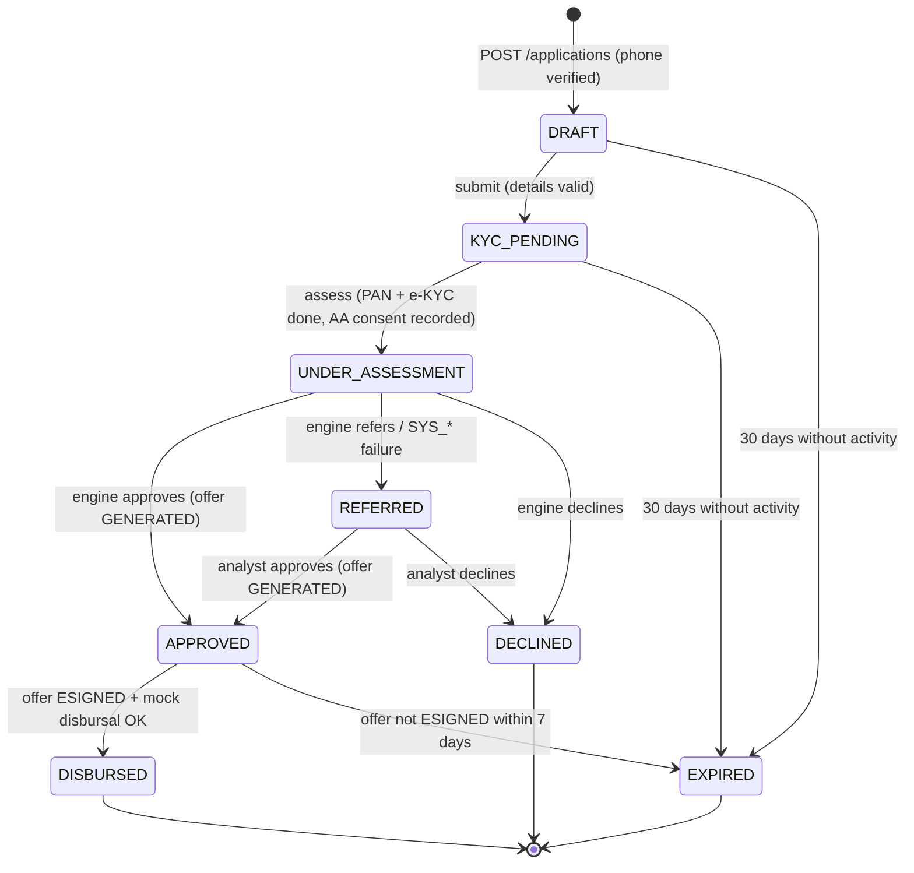
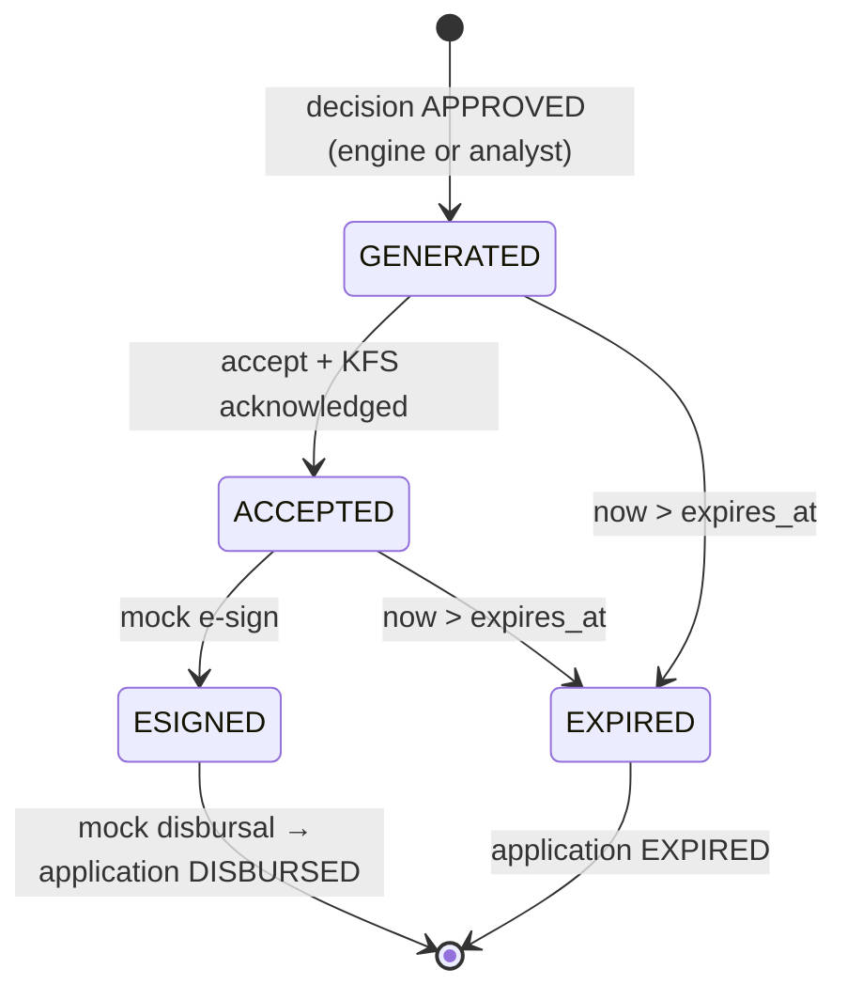

# Application State Machine

> Demo prototype. Simulated integrations and synthetic data. Not affiliated with any bank or lender.

The application lifecycle has **exactly 8 states**. The offer journey inside `APPROVED` is tracked separately on `offers.status` so the state count stays at 8.

## 1. States

| # | State | Meaning | Terminal | Owner |
|---|---|---|---|---|
| 1 | `DRAFT` | Started; phone verified; details being filled | No | Applicant |
| 2 | `KYC_PENDING` | Submitted; PAN, e-KYC and AA consent in progress or awaiting retry | No | Applicant |
| 3 | `UNDER_ASSESSMENT` | KYC done; bureau, AA data, fraud checks and rules running | No | System |
| 4 | `APPROVED` | Approved; offer generated and awaiting acceptance, e-sign and disbursal | No | Applicant |
| 5 | `REFERRED` | Sent to manual review | No | Ops analyst |
| 6 | `DECLINED` | Rejected | **Yes** | — |
| 7 | `DISBURSED` | Offer accepted, mock e-sign done, mock disbursal done | **Yes** | — |
| 8 | `EXPIRED` | Abandoned for 30 days, or offer not completed within 7 days | **Yes** | — |

`KYC_PENDING` deliberately includes the AA consent step. `UNDER_ASSESSMENT` is entered and left inside a single `POST /assess` request, so an applicant can never be stranded there. Rationale: [DECISIONS.md D-02](DECISIONS.md).

## 2. Diagram

## 3. Allowed transitions

Any transition not in this table raises `InvalidTransitionError` (API: HTTP 409, `error_code: INVALID_STATE_TRANSITION`) and writes nothing.

| From | To | Trigger | Actor | Guard |
|---|---|---|---|---|
| — | `DRAFT` | `POST /applications` | applicant | Phone verified in current session |
| `DRAFT` | `KYC_PENDING` | `POST /applications/{id}/submit` | applicant | All required details valid |
| `DRAFT` | `EXPIRED` | Expiry check | system | No activity for 30 days |
| `KYC_PENDING` | `UNDER_ASSESSMENT` | `POST /applications/{id}/assess` | applicant | PAN verified, e-KYC complete, AA consent approved or declined |
| `KYC_PENDING` | `EXPIRED` | Expiry check | system | No activity for 30 days |
| `UNDER_ASSESSMENT` | `APPROVED` | Engine decision | system | Outcome APPROVED; offer created |
| `UNDER_ASSESSMENT` | `REFERRED` | Engine decision | system | Outcome REFERRED (incl. `SYS_*`) |
| `UNDER_ASSESSMENT` | `DECLINED` | Engine decision | system | Outcome DECLINED |
| `REFERRED` | `APPROVED` | `POST /ops/referrals/{id}/review` (approve) | ops / admin | Notes present; offer created |
| `REFERRED` | `DECLINED` | `POST /ops/referrals/{id}/review` (decline) | ops / admin | Notes present |
| `APPROVED` | `DISBURSED` | `POST /applications/{id}/disburse` | system (applicant-initiated) | Offer `ESIGNED`; mock disbursal succeeded |
| `APPROVED` | `EXPIRED` | Expiry check / accept / e-sign after `expires_at` | system | Offer not `ESIGNED` and `now > expires_at` |

### Illegal-transition matrix

`✓` = allowed, `·` = rejected. Tests cover every `·` cell (64 state pairs: 11 allowed, 53 rejected — including all self-transitions and every transition out of a terminal state).

| From \ To | DRAFT | KYC_PENDING | UNDER_ASSESSMENT | APPROVED | REFERRED | DECLINED | DISBURSED | EXPIRED |
|---|---|---|---|---|---|---|---|---|
| **DRAFT** | · | ✓ | · | · | · | · | · | ✓ |
| **KYC_PENDING** | · | · | ✓ | · | · | · | · | ✓ |
| **UNDER_ASSESSMENT** | · | · | · | ✓ | ✓ | ✓ | · | · |
| **APPROVED** | · | · | · | · | · | · | ✓ | ✓ |
| **REFERRED** | · | · | · | ✓ | · | ✓ | · | · |
| **DECLINED** | · | · | · | · | · | · | · | · |
| **DISBURSED** | · | · | · | · | · | · | · | · |
| **EXPIRED** | · | · | · | · | · | · | · | · |

(Creation, `— → DRAFT`, is the only way into the machine and is not part of the matrix.)

## 4. Offer lifecycle inside `APPROVED`

| Offer status | Meaning |
|---|---|
| `GENERATED` | Offer created with terms, `policy_version` and `expires_at` = created + 7 days |
| `ACCEPTED` | Applicant ticked "I have read the Key Fact Statement" and accepted |
| `ESIGNED` | Mock e-sign completed; offer can no longer expire |
| `EXPIRED` | Not e-signed by `expires_at`; application moves to `EXPIRED` |

Rules:
- Each offer step is a separate request and a separate logged event (`event_type = OFFER_STATUS`).
- The application moves `APPROVED → DISBURSED` only after `ESIGNED` **and** a successful mock disbursal.
- An expired offer cannot be reopened; the applicant starts a new application ([DECISIONS.md D-03](DECISIONS.md)).
- Offer terms are frozen at generation and honour the decision-time `policy_version`, even if policy changes later (EC-15).

## 5. Expiry

| Case | Clock starts | Limit | Result |
|---|---|---|---|
| Abandoned `DRAFT` / `KYC_PENDING` | Last applicant activity (latest event or detail save) | 30 days | `EXPIRED`, reason `ABANDONED_30D` |
| Offer not e-signed | Offer `created_at` | 7 days (`expires_at`) | Offer `EXPIRED`, application `EXPIRED`, reason `OFFER_EXPIRED_7D` |

Expiry is applied two ways, both using an injectable clock so tests can move time:
1. **Lazily**, whenever an application is read or acted on.
2. **In bulk**, by `POST /admin/jobs/expire` (callable by a scheduler or the simulation).

`REFERRED` applications do not expire automatically; they wait for an analyst (see [DECISIONS.md D-25](DECISIONS.md)).

## 6. Event log (`application_events`)

Every state transition writes exactly one row in the same database transaction as the state change.

| Column | Type | Notes |
|---|---|---|
| `id` | UUID | |
| `application_id` | UUID | FK |
| `event_type` | enum | `STATE_CHANGE`, `OFFER_STATUS`, `FRAUD_CHECK`, `NOTE` |
| `from_state` | text, nullable | Application state, or offer status for `OFFER_STATUS`; null on creation |
| `to_state` | text, nullable | Same |
| `actor` | text | `applicant`, `system`, `ops:<username>`, `admin:<username>` |
| `reason` | text, nullable | Reason code or short reason (e.g. `ABANDONED_30D`, `FRAUD_DUPLICATE_PAN`) |
| `metadata` | JSON | Optional context (e.g. decision ID, offer ID) — never raw PAN or phone |
| `created_at` | timestamptz | From the injectable clock |

The legal-transition assertion in the simulation checks only `STATE_CHANGE` rows.

## 7. TAT computation

For each application, sort `STATE_CHANGE` events by `created_at`. Time in state *S* = timestamp of the event leaving *S* − timestamp of the event entering *S*. Per-state median and P90 are taken over applications that have **left** that state (open stays are excluded and counted separately as "currently in state"). Terminal states have no TAT.

In the simulation, TAT reflects simulated provider latency and script speed only; it says nothing about real-world turnaround.
